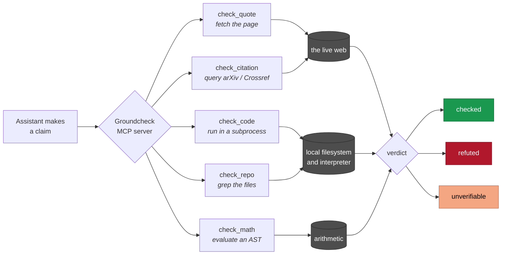
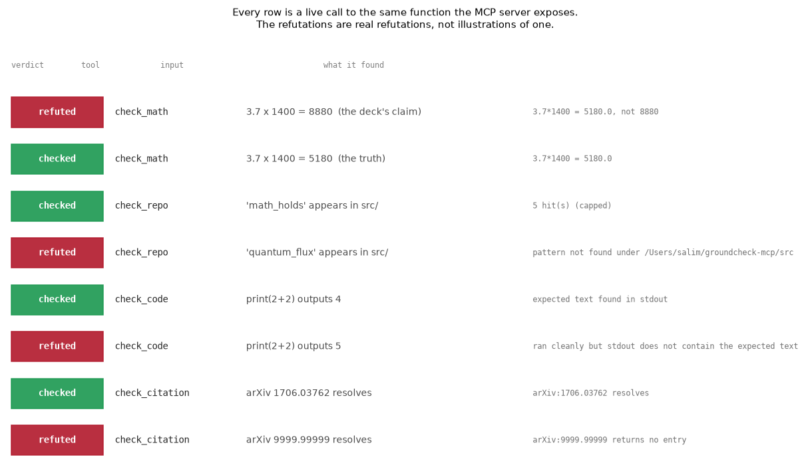
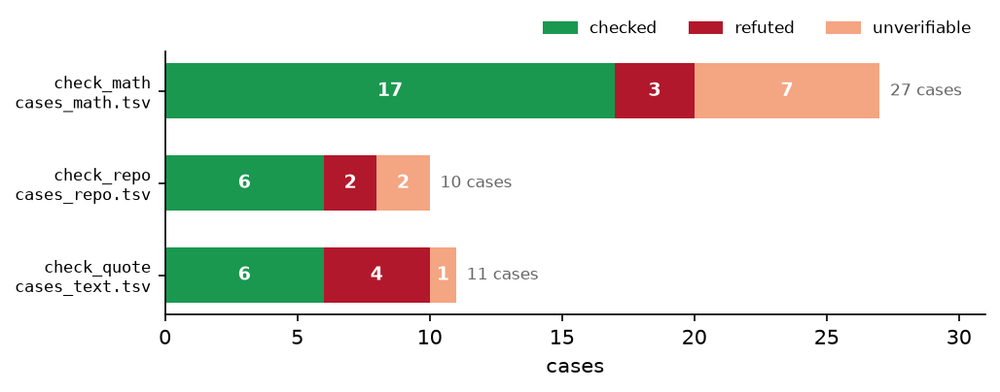
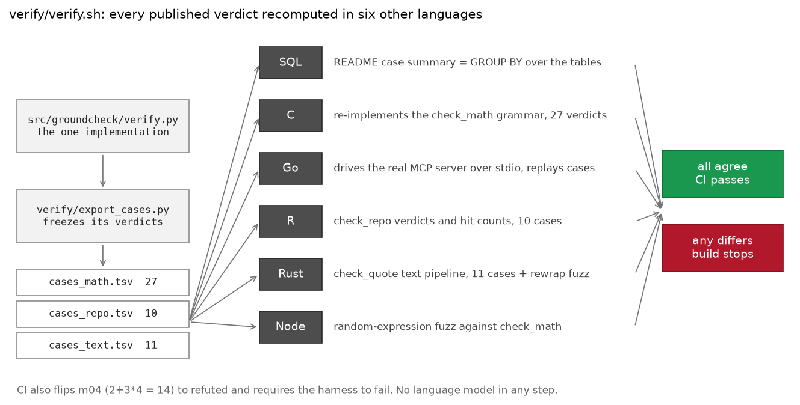

# Groundcheck, verification with no model in the loop

[](https://github.com/aghasalim/groundcheck-mcp/actions/workflows/ci.yml)
[](https://www.python.org/)
[](LICENSE)
[](https://doi.org/10.5281/zenodo.23003639)

I built this MCP connector to check whether the grounding behind a claim is
real. Is the quote actually on the page? Does the arXiv id resolve? Does the
code print what someone says it prints, and is the number right? There's no
language model anywhere in the verification path. It works in any MCP host, so
Claude, Gemini or something else. The checkers under `verify/` re-derive every
verdict it returns. They run against the same fixtures and don't share the
server's code. If a re-derivation drifts, the build stops.


---

<details>
<summary>Contents</summary>

- [Abstract](#abstract)
- [1. The three verdicts](#1-the-three-verdicts)
- [2. The tools](#2-the-tools)
- [3. Use it](#3-use-it)
- [4. Security](#4-security)
- [5. Limitations](#5-limitations)
- [6. Licence](#6-licence)
- [Citation](#citation)

</details>

## Abstract

When an assistant "fact-checks" something, it almost always asks a second
model whether the first one was right. That just moves the error somewhere
else, since the checker hallucinates too. I wanted to check grounding against
reality instead. Groundcheck has five tools. They fetch a page, resolve an
identifier, run a snippet, grep a codebase or evaluate an expression. Each one
returns one of three verdicts with the evidence attached.

I kept the scope narrow on purpose. Groundcheck confirms that the evidence a
claim rests on is real and says what it's quoted to say. It doesn't judge
whether a claim is semantically true. "This quote is on the cited page" can be
checked. "The page's argument is correct" can't. When it can't tell, it
returns `unverifiable`.

No language model is involved in any verdict.

Contributions. (i) Verification grounded in sources. (ii) A three-verdict
contract with an explicit `unverifiable`, so refusing to answer is a proper
outcome. (iii) Results you can audit, since every verdict carries the quote,
stdout, matching line or computed value it was based on.

Why I built it this way, and the mistakes each tool came from, are in
[docs/background.md](docs/background.md).

---

## 1. The three verdicts

| verdict | meaning |
|---|---|
|`checked` | the grounding was confirmed against a real source |
|`refuted` | the source exists and contradicts the claim (wrong number, missing quote, dead id, failing code) |
|`unverifiable` | no source, or it needs judgement this tool refuses to fake |



None of the boxes in that diagram is a language model. Every verdict ends at
something you can look up, run or compute.

## 2. The tools

| tool | verifies | how (no LLM) |
|---|---|---|
|`check_quote(quote, url)` | an exact quote is on a page | fetch the page, match the text |
|`check_citation(identifier)` | an arXiv id or DOI resolves | query arXiv / Crossref, return the real title |
|`check_code(snippet, expected_output)` | code prints what's claimed | run it in a subprocess, compare stdout |
|`check_repo(pattern, path)` | a string/regex is in a codebase | grep the files, return real matching lines |
|`check_math(expression, claimed_result)` | arithmetic is correct | evaluate an AST (no`eval`), compare |

Every result has the shape `{status, method, evidence, detail}`. The
`evidence` field holds whatever was actually found, like the quote, the stdout,
the matching line or the computed value. That's what makes a verdict auditable.

### 2.1 A live run



Each row above is a real call to the same function the server exposes. That
includes the arXiv lookups that need the network. The refutations are real
too. The first row is the `3.7 x 1400` error from the [background notes](docs/background.md), reproduced.

### 2.2 The case corpus

`verify/export_cases.py` writes these tables. I keep them tracked in git so CI
can corrupt one and make sure the harness notices.

| table | cases | checked | refuted | unverifiable |
|---|---|---|---|---|
| `cases_math.tsv` | 27 | 17 | 3 | 7 |
| `cases_repo.tsv` | 10 | 6 | 2 | 2 |
| `cases_text.tsv` | 11 | 6 | 4 | 1 |



The same three tables as bars, counted from the TSV files. Every table has cases for all three verdicts.



`verify/verify.sh` recomputes these verdicts in SQL, C, Go, R, Rust and Node, without sharing the server's code. The build stops if any of them disagrees.

## 3. Use it

```bash
pip install -e .          # or: pip install -r requirements.txt
python -m pytest tests/   # 23 tests, no network needed (mocked transport)
```

For Claude or Claude Code, add this to your MCP config.

```json
{
  "mcpServers": {
    "groundcheck": { "command": "python", "args": ["-m", "src.groundcheck.server"] }
  }
}
```

For Gemini CLI or any other MCP host, it's the same stdio server. Point your
host's MCP config at `python -m src.groundcheck.server`. MCP is why one
connector can serve both.

## 4. Security

`check_code` runs the code you give it in a subprocess. It uses list-form
`subprocess`, so there's no shell and nothing to inject, and it kills the
process on timeout. It isn't sandboxed from the network or the filesystem,
though. Only pass code you'd run yourself. The other four tools are read-only
(HTTP GET, file read, arithmetic).

## 5. Limitations

This checks grounding. It doesn't check truth, and that's by design (see the
Abstract).

Quote matching is exact, apart from normalising whitespace. A paraphrase that
means the same thing returns `refuted`. Deciding that two sentences "mean the
same" needs a judge, and this tool refuses to be one. Match the literal text.

`check_quote` reads the served HTML, so it won't find a quote on a JS-rendered
page that client-side JavaScript injects. It fails safe with `refuted` and
never gives a false `checked`.

Citations only go through arXiv and Crossref. Other registries aren't wired up
yet.

## 6. Licence

MIT, see [LICENSE](LICENSE).

## Citation

If you use this work, please cite it. The same record is in [`CITATION.cff`](CITATION.cff).

```bibtex
@software{mustafazada2026groundcheckmcp,
  author  = {Mustafazada, Aghasalim},
  title   = {Groundcheck: grounded verification with no model in the loop},
  year    = {2026},
  version = {1.0.1},
  doi     = {10.5281/zenodo.23003639},
  url     = {https://github.com/aghasalim/groundcheck-mcp}
}
```
